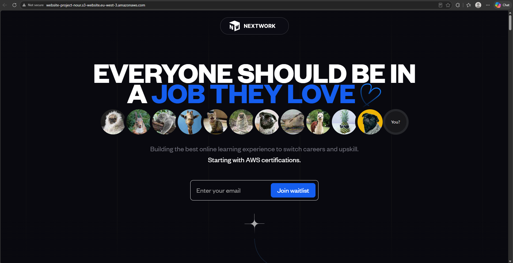
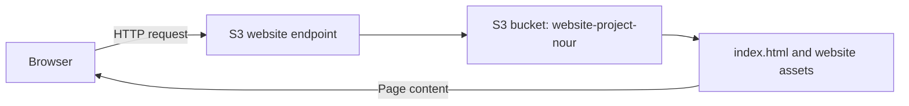
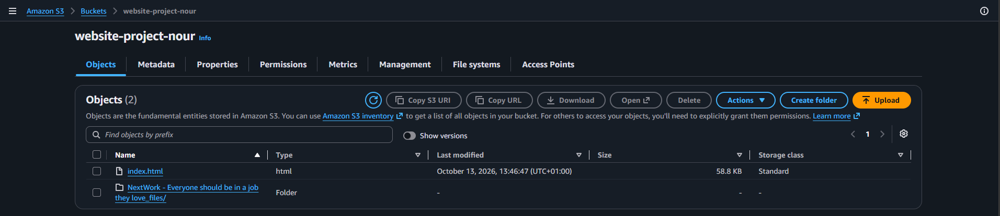
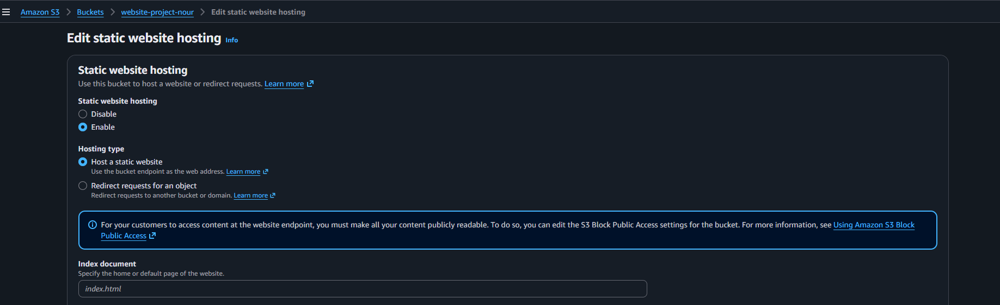
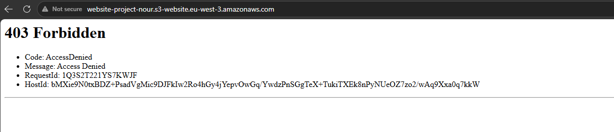
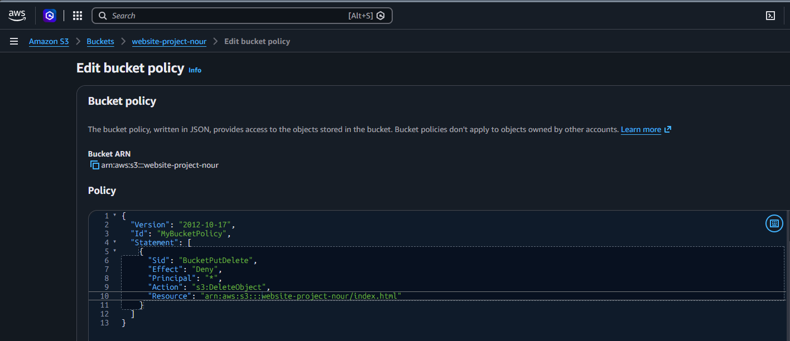

# Static Website Hosting with Amazon S3

A beginner AWS mini project: hosting a sample website on Amazon S3 and documenting the journey from an access error to a successfully rendered page.

Completed as a guided lab using [NextWork — Host a Website on Amazon S3](https://nextwork.ai/projects/70e2d059-31ab-5f67-8c58-f5edbd451140?track=high). The sample website design and assets are from NextWork; my work was deploying the sample in AWS and capturing the results.



## Project at a glance

| Item | Details |
| --- | --- |
| Service | Amazon S3 |
| Tools | AWS Management Console and web browser |
| Bucket | `website-project-nour` |
| Region shown in endpoint | `eu-west-3` |
| Entry page | `index.html` |
| Evidence captured | October 13, 2026 |
| Result | Website rendered at the S3 website endpoint in the final screenshot |

This repository contains the project write-up and five screenshots. It does not contain the website source or automated deployment scripts. The screenshots record the lab result; current endpoint availability and resource cleanup have not been verified.

## How it works



The browser requests the website through the bucket's website endpoint. S3 serves the index page and the assets the page references.

## Walkthrough and evidence

### 1. Upload the website files

The bucket's Objects tab shows `index.html` and the `NextWork - Everyone should be in a job they love_files/` asset folder. The HTML file is shown as 58.8 KB in S3 Standard storage.



### 2. Configure static website hosting

The hosting configuration screen shows **Enable**, **Host a static website**, and `index.html` in the index document field. This image captures the settings form; the final browser screenshot provides evidence of the working website endpoint.



### 3. Investigate the access error

The first captured browser result was **403 Forbidden**, with the code **AccessDenied**.



Enabling hosting and granting permission to read the content are separate steps. AWS documents that an existing object without read permission can return a 403 response at the website endpoint. See [AWS: Setting permissions for website access](https://docs.aws.amazon.com/AmazonS3/latest/userguide/WebsiteAccessPermissionsReqd.html).

The linked tutorial's resolution is to make the website objects publicly readable using ACLs. The provided screenshots do not capture the permission change, so they do not establish whether ACLs, a bucket policy, or another setting was changed in this lab.

### 4. Verify the page loads

The final screenshot shows the NextWork sample page, including its images, rendered at the same endpoint that previously returned the error:

```text
http://website-project-nour.s3-website.eu-west-3.amazonaws.com
```

This demonstrates that the page loaded at capture time. It does not verify every link or the email waitlist form.

### 5. Explore a bucket policy to prevent deletion

For the tutorial's optional bucket-policy exercise, the additional screenshot shows a policy in the editor targeting `index.html`. Its statement denies `s3:DeleteObject` to all principals (`"Principal": "*"`) for that specific object.



Policy transcribed from the screenshot:

```json
{
  "Version": "2012-10-17",
  "Id": "MyBucketPolicy",
  "Statement": [
    {
      "Sid": "BucketPutDelete",
      "Effect": "Deny",
      "Principal": "*",
      "Action": "s3:DeleteObject",
      "Resource": "arn:aws:s3:::website-project-nour/index.html"
    }
  ]
}
```

The screenshot captures the policy being edited, but does not show a successful save or a deletion test. This statement concerns deletion; it does not grant public read access or establish what resolved the earlier website access error.

## Key takeaways

- An S3 bucket can hold an HTML entry page and its supporting assets.
- Static website hosting uses an index document to serve the home page.
- A configured website endpoint still needs readable content.
- Capturing both the error and the successful result makes troubleshooting easier to explain.
- A bucket policy can target a specific object and action, as shown by the deletion-deny statement for `index.html`.

The browser's **Not secure** label is consistent with this HTTP endpoint: S3 website endpoints do not support HTTPS. See [AWS: Website endpoints](https://docs.aws.amazon.com/AmazonS3/latest/userguide/WebsiteEndpoints.html).

## Follow-up notes

- **Permissions evidence:** add a screenshot or short note confirming the change that resolved the 403 error.
- **Bucket-policy verification:** confirm that the deletion-deny policy was saved and capture the result of testing it.
- **Cleanup status:** confirm whether the lab bucket and objects have been removed or are intentionally being kept. Cleanup is not shown in this evidence.
- **Possible next project:** add HTTPS delivery with CloudFront and document the new architecture.

## Credits

Tutorial and sample website: [NextWork — Host a Website on Amazon S3](https://nextwork.ai/projects/70e2d059-31ab-5f67-8c58-f5edbd451140?track=high). This is a learning portfolio entry based on that guided project, not a claim of authorship of the NextWork website.
